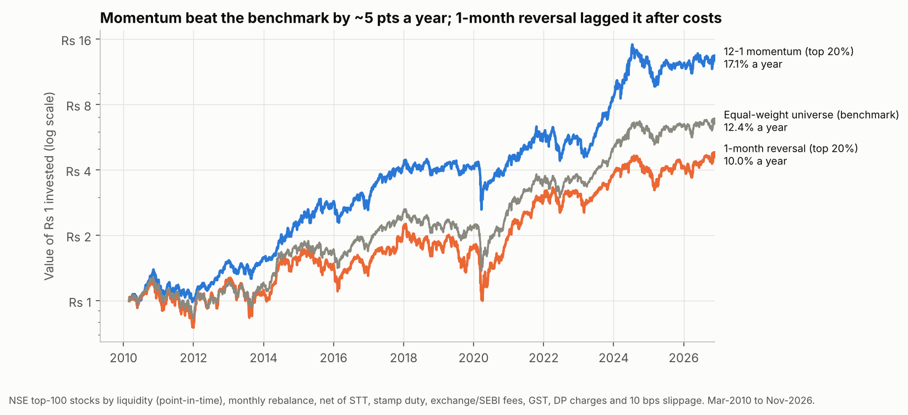
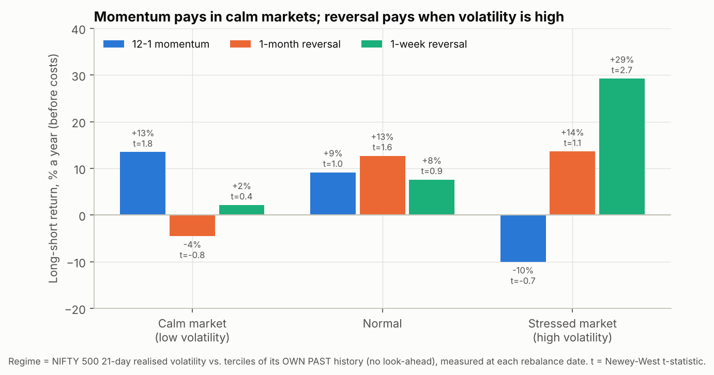
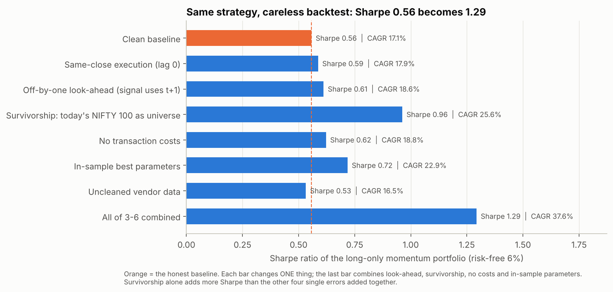
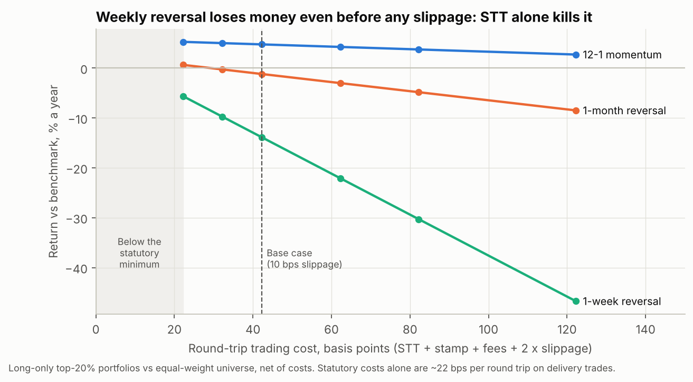
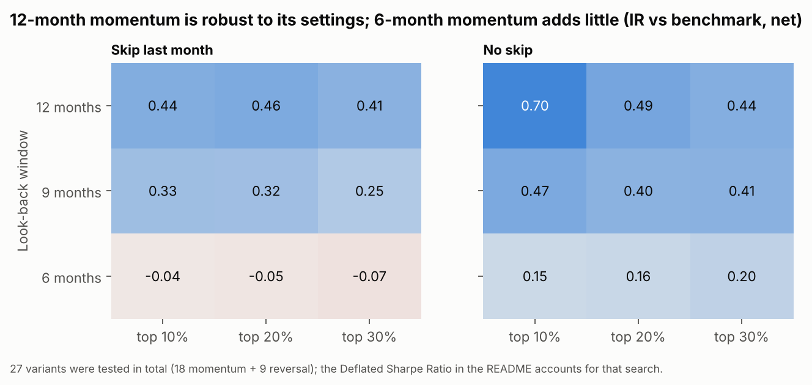
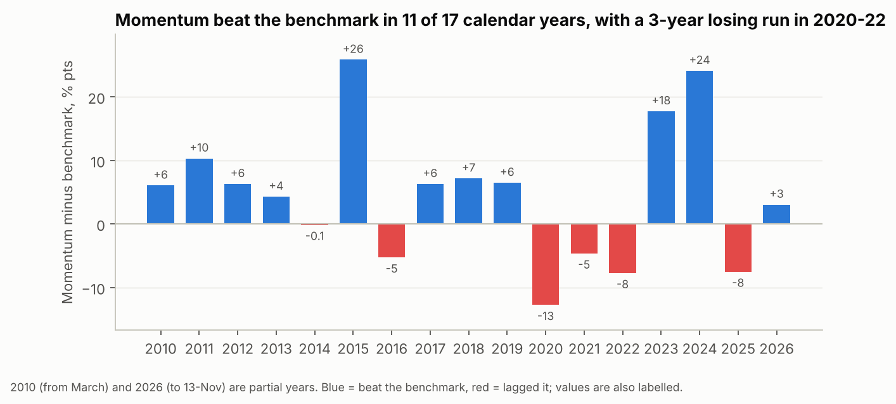

# Momentum or Mean Reversion? A Regime-Aware, Bias-Audited Study of NSE Large Caps

A research project that asks a simple question with real rigour: **do medium-term momentum
and short-term reversal earn money in Indian large-cap stocks once you account for Indian
transaction costs, market regimes and the usual backtesting mistakes?**

Everything is computed from point-in-time data, net of the actual Indian cost stack (STT,
stamp duty, exchange and SEBI fees, GST, DP charges, slippage), validated out of sample,
and checked by a test suite that proves the engine cannot see the future.



## Key findings

| # | Finding | Evidence |
|---|---------|----------|
| 1 | **12-1 momentum is the only signal that survives costs.** Long-only top-20% portfolio: **17.1% CAGR vs 12.4%** for the equal-weight benchmark, **+4.8 pts/yr active**, IR 0.46. | Break-even cost 93 bps per side vs ~21 bps modelled, so it has a 4x margin of safety on costs. |
| 2 | **…but the edge is statistically modest.** Active IR 95% block-bootstrap CI is **[-0.09, 0.98]**; Newey-West t = 1.74. It lost to the benchmark in 2020, 2021 and 2022. | `results/tables/confidence.csv`, figure 6 |
| 3 | **Short-term reversal is real before costs and dead after them.** Weekly reversal long-short has a gross Sharpe of **0.55** (CI 0.10–1.02) but a net Sharpe of **-1.51**. Its break-even cost is **5.5 bps per side**, below the **10 bps STT** alone. | Figure 4. STT on delivery trades, not slippage, is what makes it untradeable in Indian cash equities. |
| 4 | **The two effects are regime-dependent, in opposite directions.** Momentum earns +13.5%/yr in calm markets and **-10%/yr in stressed ones**. 1-month reversal earns -4.5% in calm markets and **+13.6% in stressed ones**. The pattern is stronger with India VIX regimes (momentum +22%, t = 3.6, in low-VIX periods). | Figure 2. Regimes use only past data. |
| 5 | **…yet timing the regime did not help out of sample.** A walk-forward regime switch earned an IR of 0.47 vs 0.46 for plain momentum. The hindsight version shows 0.61. The pattern is real but too episodic (few high-vol episodes) to exploit. | `results.json → regime_switch` |
| 6 | **Backtest errors matter more than strategy choice.** The same momentum strategy shows Sharpe **0.56** honestly and **1.29** (CAGR 37.6%) with four common mistakes. Survivorship bias alone takes the *benchmark* from 12.4% to **22.1% CAGR**. | Figure 3 |
| 7 | **Look-ahead bias distorts results; it doesn't only inflate them.** An off-by-one bug lifts momentum's Sharpe (0.38 → 0.47) but turns weekly reversal's 0.55 into -4.7. The faster the signal, the bigger the distortion. | `lookahead_by_signal_speed.csv` |
| 8 | **ML found signal but not profit.** Walk-forward ridge and gradient-boosting rankers had positive out-of-sample rank IC (0.034 / 0.038, positive in 9 and 11 of 14 years). Higher turnover (6–7x vs 3.3x) made them lose to the single momentum signal after costs. | `ml_ranker.csv` |





## Research design

| Choice | What was done | Why |
|---|---|---|
| **Universe** | Each month, the 100 most liquid NSE stocks by 6-month median traded value, from a pool of the current NIFTY 500 plus former large caps that were delisted or merged. Needs 13 months of history and 90% trading-day coverage. | Point-in-time, with no hindsight about which companies survived. 259 distinct stocks pass through it; monthly churn is 3.3%. |
| **Signals** | `MOM_12_1`: return from t-12m to t-1m. `REV_1M`: minus the last 21-day return. `REV_1W`: minus the last 5-day return. | Classic definitions, fixed **before** looking at results. A 27-variant parameter grid is reported separately. |
| **Portfolios** | Long-only top 20% (the tradable version) and long-short top-minus-bottom 20% (a research measure of signal strength). Equal-weight, monthly rebalance (weekly for `REV_1W`). | Retail and most funds cannot short Indian cash equities overnight, so the long-only portfolio is the honest, implementable test. |
| **Timing** | Decide at the close of day *t*, trade at the close of *t+1*. | Trading at the same close that produced the signal isn't achievable. Row 2 of the bias audit measures what that shortcut is worth. |
| **Costs** | STT 0.1% each side (0.125% before Jul-2012), stamp duty 0.015% on buys, NSE 0.00297%, SEBI 0.0001%, 18% GST on fees, zero brokerage, ₹15.34 DP charge per stock sold, **10 bps slippage per side (assumption)**. About 42 bps per round trip. | Verified against current broker charge pages and exchange circulars (Nov 2026). Slippage is varied from 0 to 50 bps in figure 4. |
| **Regimes** | 21-day realised volatility of NIFTY 500, classified LOW / MID / HIGH against the terciles of its **own past history** (expanding window). India VIX as a robustness check. | Full-sample terciles would leak future information about how volatile later years were. |
| **Validation** | Newey-West t-stats, 1-month block bootstrap CIs, Probabilistic and Deflated Sharpe Ratio (27 trials), yearly walk-forward parameter selection (2013–2026), cost and parameter sensitivity. | A single Sharpe ratio from one backtest says very little on its own. |
| **Benchmark** | Equal-weight version of the same universe, with the same costs. | Isolates the signal from simply holding liquid large caps. (NIFTY 50 price index: 10.5% CAGR over the same period, without dividends.) |

## Results tables

**Core strategies (net of costs, Mar-2010 to Nov-2026)**

| Strategy | CAGR | Sharpe (rf 6%) | Max DD | Turnover/yr | Cost drag/yr | Active vs EW | IR |
|---|---|---|---|---|---|---|---|
| 12-1 momentum, long-only | 17.1% | 0.56 | -41.6% | 3.3x | 1.5% | **+4.8%** | **0.46** |
| 1-month reversal, long-only | 10.0% | 0.27 | -55.8% | 9.9x | 4.3% | -1.2% | -0.12 |
| 1-week reversal, long-only | -3.0% | -0.25 | -78.6% | 41.9x | 18.1% | -13.8% | -1.31 |
| Equal-weight universe | 12.4% | 0.40 | -48.0% | 0.8x | 0.4% | – | – |

| Long-short (research measure) | Sharpe gross | Sharpe net |
|---|---|---|
| 12-1 momentum | 0.37 | 0.22 |
| 1-month reversal | 0.27 | -0.20 |
| 1-week reversal | 0.55 | -1.51 |

**Bias audit: one change at a time to the momentum backtest**

| Variant | Long-only CAGR | Long-only Sharpe | Δ Sharpe |
|---|---|---|---|
| Clean baseline | 17.1% | 0.56 | – |
| Same-close execution | 17.9% | 0.59 | +0.03 |
| Off-by-one look-ahead | 18.6% | 0.61 | +0.05 |
| Survivorship (today's NIFTY 100) | 25.6% | 0.96 | **+0.40** |
| No transaction costs | 18.8% | 0.62 | +0.06 |
| In-sample best parameters | 22.9% | 0.72 | +0.16 |
| Uncleaned vendor data | 16.5% | 0.53 | -0.03 |
| Look-ahead + survivorship + no costs + best params | **37.6%** | **1.29** | **+0.74** |

**Overfitting check:** the best of 27 variants (12-month momentum, no skip, top 10%) has a
full-sample IR of 0.70 and a Probabilistic Sharpe Ratio of 0.998. After deflating for the 27
trials, its **Deflated Sharpe Ratio is 0.49**, so the apparent edge is no longer
significant. Picking parameters each January from past data only still gave an out-of-sample
(2013–2026) IR of **0.67**. The selection was stable: a 12-month look-back won every year.







All numbers are in `results/tables/*.csv` and `results/results.json`, generated by `scripts/run_all.py`.

## Data quality: what was fixed and why

Free Yahoo Finance data for NSE has known defects. Every fix is a written rule and every
change is logged in `results/tables/data_corrections.csv`:

- **Placeholder prices** (470 stocks): before a stock's real history starts, Yahoo repeats a stale price with zero volume. A zero-volume print is treated as no trade.
- **One-to-two-day glitches** (4 cases): a ≥35% jump that reverts within two sessions. An earlier, looser rule wrongly "fixed" real events (the Feb-2023 Adani crash, March-2020 IndusInd), so it was tightened and that's documented.
- **Unadjusted splits and bonuses** (4 cases, e.g. GPIL 5:1 and CGCL 4:1 in Jan-2024): detected by price ratio.
- **Demergers** (5 cases: Tata Motors 2025, Vedanta 2026, HEG 2026, Century Textiles 2019, Jindal Stainless 2015): each verified against exchange filings or press reports with the source in `data/corporate_actions.csv`. The event-day drop is not treated as a loss to shareholders.
- **Kept as genuine:** Yes Bank (Mar-2020), Jet Airways (2019), the PSU-bank rally (Oct-2017), RCOM (2018).

## Limitations (stated, not hidden)

- **Residual survivorship bias.** Only 5 of 37 delisted or merged former large caps (e.g. HDFC Ltd, DHFL, Cairn) are available from free data. The point-in-time universe reduces but cannot remove this bias. The missing names inflate the *absolute* returns of every portfolio, including the benchmark. Their effect on momentum's *active* return could go either way: momentum would mostly have avoided steady decliners (raising active return), but it could also have held a former winner that collapsed suddenly (lowering it).
- **Slippage is an assumption** (10 bps per side for top-100 stocks); figure 4 shows how results change with it.
- **High-volatility regimes are rare**: 776 of 4,112 days (19%), concentrated in a few episodes (mostly 2011, 2015–16, 2020–22 and 2025). Regime t-statistics are correspondingly weak, and five or six episodes are a small sample for a timing rule.
- **Close-to-close execution** at daily closing prices; no intraday modelling, no capacity analysis.
- **Demerger neutralisation** treats the event-day total return as 0%, because the spun-off company's price is not in the data.
- Constant 6% risk-free rate (approximate 2010–26 average 91-day T-bill) for long-only Sharpe ratios.

## Reproduce

```bash
python -m venv .venv && .venv/bin/pip install -r requirements.txt     # Windows: .venv\Scripts\...
python download_data.py          # ~10 min, needs internet: writes data/raw/
python scripts/run_all.py        # ~1 min: all tables + results.json + SQLite store
python scripts/make_figures.py   # figures
python -m pytest -q              # 10 tests, incl. no-look-ahead proofs
```

```
├── download_data.py            # only network step; coverage report with file hashes
├── data/corporate_actions.csv  # verified demergers, with sources
├── src/nsequant/
│   ├── data.py       # cleaning rules + SQLite store
│   ├── universe.py   # point-in-time liquidity universe
│   ├── signals.py    # momentum, reversal, features
│   ├── regimes.py    # expanding-window volatility regimes
│   ├── costs.py      # Indian delivery cost model
│   ├── backtest.py   # daily engine: explicit timing, drift, costs
│   ├── metrics.py    # Sharpe, NW t-stat, bootstrap CI, PSR, DSR
│   ├── ml.py         # walk-forward ridge / gradient-boosting ranker
│   └── research.py   # Study object tying it together
├── scripts/run_all.py, make_figures.py
├── tests/test_engine.py        # look-ahead, accounting, cleaning, metrics
├── results/                    # tables, figures, results.json
└── reports/RESEARCH_NOTE.md    # methodology and discussion
```

## Next steps

1. **Implement reversal through single-stock futures**, where STT is charged only on the sell side, to test whether the gross weekly reversal premium survives a cheaper instrument.
2. **Volatility-scaled momentum**: scale exposure down when regime volatility rises, rather than switching signals, to address the high-volatility crashes in finding 4.
3. **Capacity**: model market impact as a function of order size relative to average daily value traded.
4. **Purchase a survivorship-free dataset** to close the gap in the first limitation.
